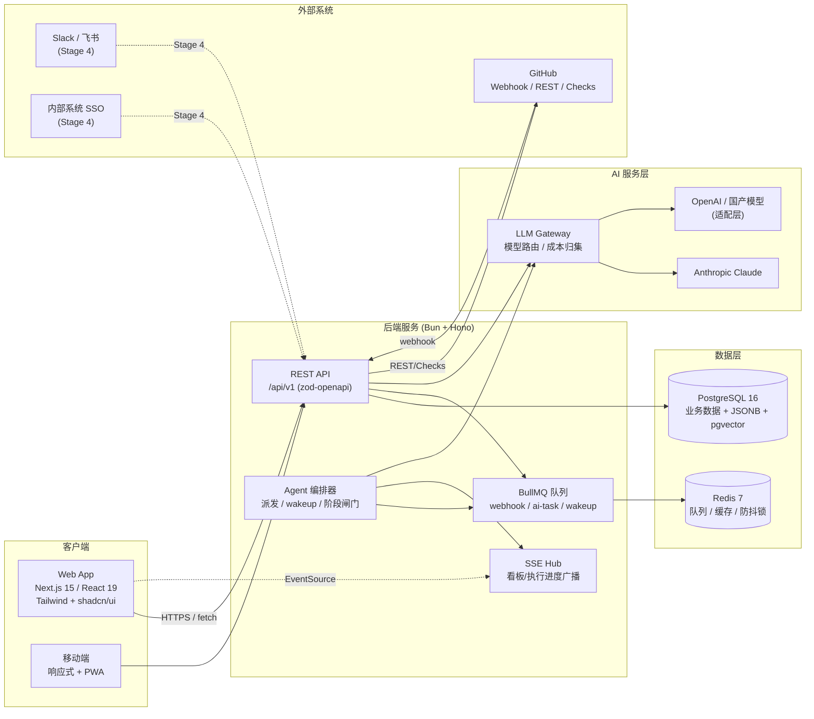
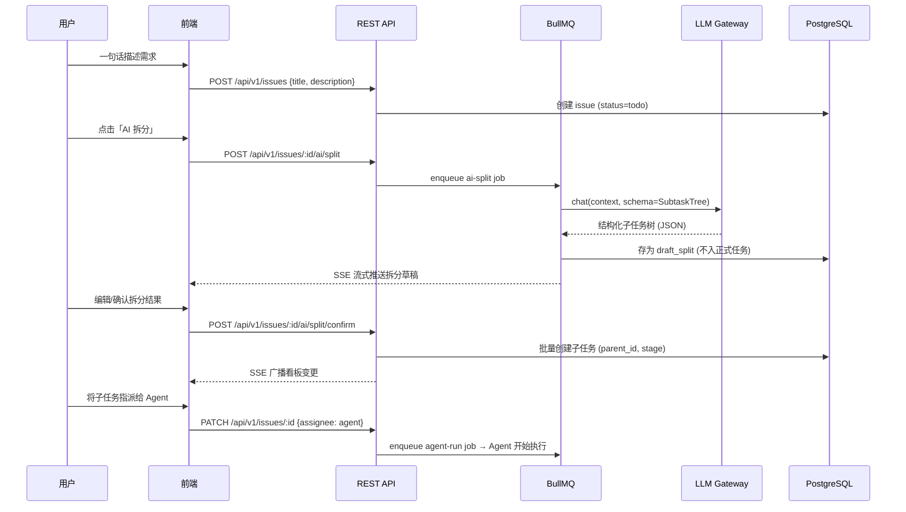
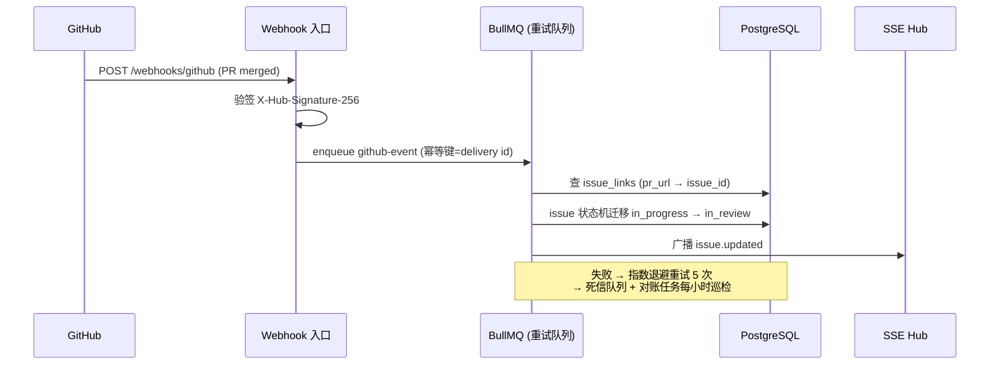
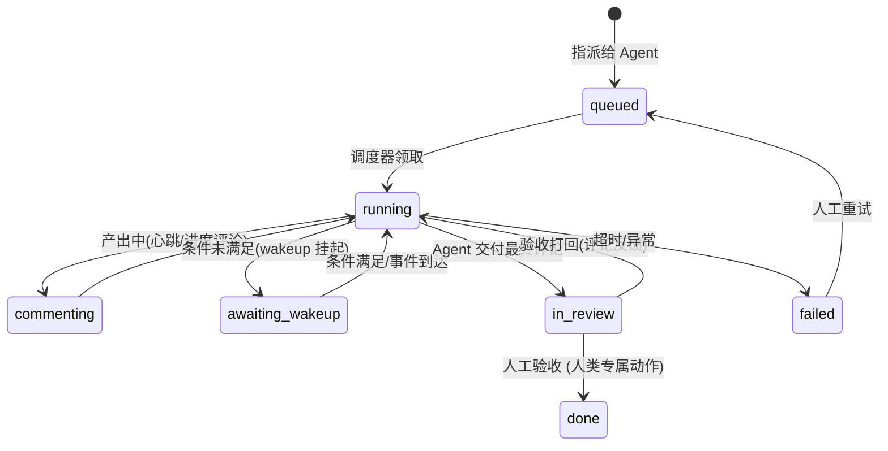
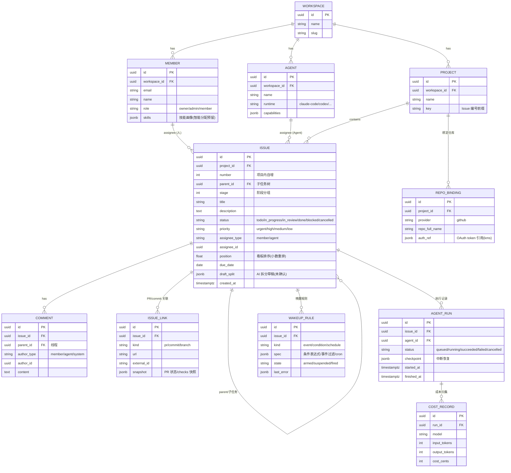
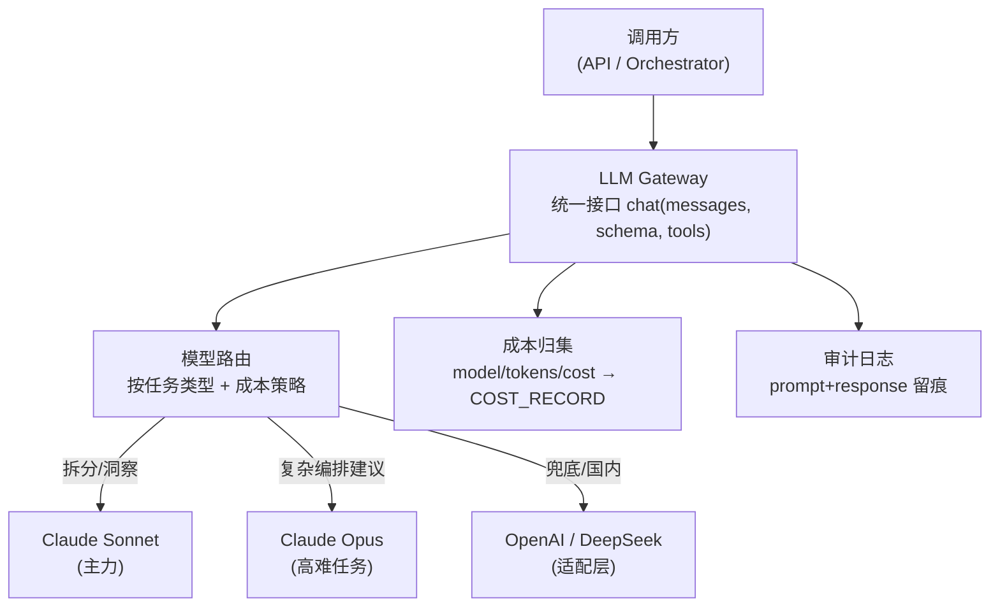

# 技术架构设计

> 项目：AI 智能项目协作平台 | 阶段：Stage 2 (DEV-4) | 日期：2026-10-14
> 配套文档：[技术选型](./tech-selection.md) | [产品原型](./prototype/README.md)

## 一、系统架构总览



**架构要点**：

- **单体优先**：MVP 是一个 Hono 应用 + 一个 Next.js 应用，模块（orchestrator / gateway / integrations）以包内模块划分，不做微服务拆分。
- **异步一律走队列**：webhook 处理、AI 调用、wakeup 判定都是 BullMQ job，API 只做同步快路径，保证 p99 不被 LLM 延迟污染。
- **状态由产出驱动**（差异化 D2）：GitHub webhook → 队列 → 状态机迁移 → SSE 广播，无人工拖拽。

## 二、核心流程

### 2.1 创建任务 → AI 拆分 → 派发（差异化 D4 + D1）



**关键设计**：AI 拆分产物先落 `draft`（人工可编辑），**确认后才创建真实子任务**——对应 DEV-3 风险结论「定位为草稿生成器，保留人工编辑环节」。

### 2.2 GitHub 状态联动（差异化 D2）



### 2.3 Agent 执行闭环



- 每个 Agent 执行（run）有 checkpoint 日志，支持中断恢复（DEV-3 技术风险对策）。
- wakeup 条件（N1）由编排器统一评估：事件型（comment.created）、条件型（PR checks 绿、子任务全完成）、定时型，带防抖与每 issue 触发配额。

## 三、数据模型



**设计说明**：

1. **assignee 多态**：`assignee_type + assignee_id` 双字段而非单 FK——人和 Agent 都是一等 assignee（差异化 D1），查询时按 type 分发 join。
2. **看板排序**：`position` 用浮点小数重排（移动卡片只改一行），定期整理任务重归一化。
3. **Issue 编号**：`(project_id, number)` 复合唯一，`project.key + '-' + number` 形成人类可读 ID（如 ACP-42），供 commit message 引用关联。
4. **幂等与对账**：webhook 事件以 `delivery id` 去重；`ISSUE_LINK.snapshot` 存最后一次 checks 状态，对账任务与 GitHub 拉取比对。
5. **敏感信息**：OAuth token 不落明文，`auth_ref` 指向 KMS/环境密钥。

## 四、API 接口设计规范

### 4.1 总则

- **风格**：REST，`/api/v1` 前缀；OpenAPI 3.1 由 zod-openapi 从代码生成（代码即契约）。
- **认证**：`Authorization: Bearer <token>`（better-auth session token）；集成调用用 PAT（Personal Access Token）。
- **分页**：cursor 分页 `?cursor=xxx&limit=50`，响应带 `next_cursor`；不用 offset（看板高频变动下 offset 会错位）。
- **错误格式**（统一）：

```json
{
  "error": {
    "code": "ISSUE_NOT_FOUND",
    "message": "Issue acp-42 not found",
    "details": {},
    "request_id": "req_01J..."
  }
}
```

- **幂等**：所有 mutating POST 接受 `Idempotency-Key` 头，24h 内重放返回首次结果。
- **速率限制**：令牌桶，按 token 计；超限返回 `429` + `Retry-After`。

### 4.2 核心资源端点

| 方法 | 路径 | 说明 |
|---|---|---|
| GET | `/api/v1/projects/:id/issues?view=board&stage=2` | 看板视图（按状态分组 + position 排序） |
| POST | `/api/v1/issues` | 创建任务（支持 `Idempotency-Key`） |
| PATCH | `/api/v1/issues/:id` | 更新字段/状态迁移/指派（人 or Agent） |
| POST | `/api/v1/issues/:id/move` | 看板拖拽 `{status, before_id?, after_id?}` → 服务端算 position |
| POST | `/api/v1/issues/:id/ai/split` | 请求 AI 拆分（异步，SSE 推送草稿） |
| POST | `/api/v1/issues/:id/ai/split/confirm` | 确认拆分草稿 → 批量建子任务 |
| POST | `/api/v1/issues/:id/ai/suggest-assignee` | 智能分配建议（规则引擎，MVP 后接 ML） |
| GET/POST | `/api/v1/issues/:id/comments` | 评论/线程 |
| POST | `/api/v1/issues/:id/wakeups` | 创建唤醒规则 |
| GET | `/api/v1/issues/:id/runs` | Agent 执行历史 + 成本 |
| POST | `/api/v1/projects/:id/repo-bindings` | 绑定 GitHub 仓库（OAuth 回调） |
| POST | `/webhooks/github` | GitHub webhook 入口（验签 + 入队） |
| GET | `/api/v1/events?project_id=` | SSE 订阅（看板/执行进度广播） |

### 4.3 状态机约束（API 层强制）

```
todo → in_progress → in_review → done
  ↓        ↓             ↓
blocked ←─┘        (打回) in_progress
任意 → cancelled（终态）
```

- `done` 仅人类角色可写入（Agent 最高到 `in_review`）——验收权在人类，这是 D1 的信任边界。
- 非法迁移返回 `409 INVALID_TRANSITION` 并附带允许的目标状态列表。

## 五、AI 服务集成方案

### 5.1 LLM Gateway 架构



### 5.2 关键 Prompt 设计原则

| 场景 | 策略 |
|---|---|
| 任务拆分 | **Tool-use 强制 Schema**：子任务树以 tool 参数返回，杜绝 JSON 解析失败；context 注入项目历史任务标题（few-shot 风格对齐） |
| 智能分配 | MVP 用**规则引擎**（标签→技能匹配 + 当前负载），LLM 只做解释生成；数据积累后再上模型（DEV-3 结论：冷启动无解） |
| 进度洞察 | 输入为结构化状态快照（非原始评论流），输出带引用 issue 编号的摘要；温度 0 |
| 上下文管理 | 滑动窗口：issue 本体 + 父链 + 最近 20 条评论 + 相关 PR 快照；超限时先压缩评论为摘要 |

### 5.3 成本控制（差异化 D5 的实现基础）

- 每次调用记录 `model / input_tokens / output_tokens / cost_cents`，按 `run → issue → project` 三级归集。
- 看板卡片直接展示累计成本；项目维度日报。
- 硬护栏：单 issue 日配额、单 run 超时（MVP 默认 30 分钟）、超过阈值强制转人工。

## 六、非功能性设计

| 维度 | 方案 |
|---|---|
| 性能 | 看板查询走 `(project_id, status, position)` 复合索引；SSE 推送替代轮询；列表接口默认 limit=50 |
| 可靠性 | webhook/AI 任务全部队列化 + 指数退避；GitHub 事件按小时对账 |
| 安全 | 参数化查询（Drizzle）、zod 全量入参校验、CSP + CORS 白名单、webhook 验签、token 走 KMS |
| 可观测 | 结构化日志（pino）+ request_id 贯穿；Agent run 全量审计（D5 也是合规卖点） |
| 测试 | Vitest 单测（状态机/队列逻辑）+ Playwright E2E（核心流程）+ webhook 重放测试 |

## 七、与下游任务的衔接

| 下游 | 本架构提供的接口预留 |
|---|---|
| DEV-5 基础看板 | §三 数据模型（Issue/Comment/Project/Member）+ §4.2 看板端点，可直接开工 |
| DEV-6 AI 任务助手 | §5 LLM Gateway 接口与 Prompt 策略；`draft_split` 字段与 confirm 流程 |
| DEV-7 GitHub 集成 | §2.2 webhook 流水线 + `REPO_BINDING` / `ISSUE_LINK` 模型 |
| DEV-8/9 通讯/内部系统 | SSE Hub 的通知事件流可复用；`MEMBER.role` 与认证层预留 SSO 扩展点 |

## 八、风险提示

1. **Agent 长任务稳定性**是最大技术不确定性（DEV-3 结论）：MVP 强制单 run 超时 + 人工验收节点，checkpoint 日志先行。
2. **wakeup 条件风暴**：高频触发需防抖 + 每 issue 配额，编排器实现时先做配额再做多条件。
3. **多态 assignee 的报表复杂度**：BI 类聚合查询需要 UNION 视图，建表时同步建 `v_issue_assignee` 视图避免后期返工。
4. **LLM 输出漂移**：拆分 Schema 变更需版本化（`split_schema_version` 字段），防止新旧草稿混用。
